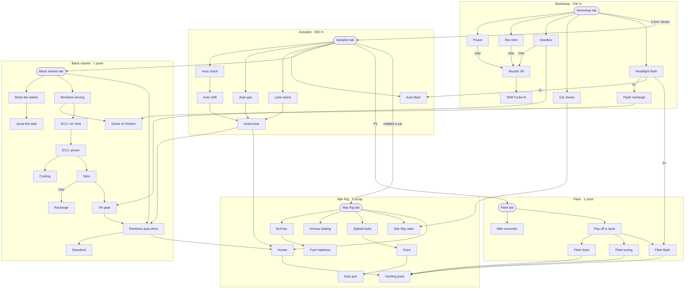

# The upgrade graph

Read from the owner's drawing (two sheets, 23 Oct): every tab is bought now, at a suggested price, so every upgrade has
a parent. A draft to fix: correct anything misread in place, and answer the questions at the end.

How it reads: an arrow points from what an upgrade needs to the upgrade. **max** on an arrow: that parent maxed. **5+**:
five levels of it. A label on a tab's arrow is a condition besides the price.

## The tabs

| Tab | Price | Needs | And |
|---|---|---|---|
| Workshop | 100 m | nothing: the first buy | |
| Autopilot | 500 m | Workshop | 2 km+ driven |
| Black market | 1 point | Autopilot | |
| Fleet | 1 point | Autopilot | P1 |
| War Rig | 1 scrap | Autopilot | totalled a car |

## The graph

## The chain

Each upgrade and what it needs, one line each: the list to edit.

### Workshop (100 m; needs nothing)

- Power ← Workshop
- Rev limit ← Workshop
- Gearbox ← Workshop
- Car stereo ← Workshop
- Headlight flash ← Workshop
- Muscle V8 ← Power max, Rev limit max, Gearbox max
- JDM Turbo I6 ← Muscle V8
- Flash recharge ← Headlight flash 5+

### Autopilot (500 m; needs the Workshop, and 2 km+ driven)

- Auto clutch ← Autopilot
- Auto gas ← Autopilot
- Lane assist ← Autopilot
- Auto flash ← Autopilot, Headlight flash 5+
- Auto shift ← Auto clutch
- Autocruise ← Lane assist, Auto shift, Auto gas

### Black market (1 point; needs the Autopilot)

- Bribe the starter ← Black market
- Jump the start ← Bribe the starter
- Reckless driving ← Black market
- Game of chicken ← Reckless driving, Flash recharge
- ECU: rev limit ← Reckless driving
- ECU: power ← ECU: rev limit
- Cooling ← ECU: power
- Nitro ← ECU: power
- Recharge ← Nitro max
- 7th gear ← Nitro, Gearbox
- Reckless auto-drive ← Black market, Autocruise, 7th gear
- Daredevil ← Reckless auto-drive

### Fleet (1 point; needs the Autopilot, and P1)

- Mile converter ← Fleet
- Pay off a racer ← Fleet
- Fleet dues ← Pay off a racer
- Fleet tuning ← Pay off a racer
- Fleet flash ← Pay off a racer, Headlight flash 5+

### War Rig (1 scrap; needs the Autopilot, and a car totalled)

- Bull bar ← War Rig
- Fuel madness ← Bull bar
- Armour plating ← War Rig
- Spiked hubs ← War Rig
- Guns ← Spiked hubs
- Auto gun ← Guns
- War Rig radio ← War Rig, Car stereo
- Hunter ← War Rig, Autocruise, Reckless auto-drive
- Hunting pack ← Hunter, Fleet dues, Fleet tuning, Fleet flash

## What changes against today's game

- **The tabs are bought**: today the Workshop and the Autopilot are open from the start, the Black market opens with
  the reveal, the Fleet at P1, the War Rig with the first car totalled.
- **Muscle V8** needs Power, Rev limit and Gearbox maxed; today it is 4,000 m with nothing before it.
- **Flash recharge** needs 5 flashes; today 10, and only after the reveal.
- **Game of chicken** needs Flash recharge; today Headlight flash.
- **The ECU** is a chain: ECU: rev limit, then ECU: power, then Cooling and Nitro; today all three of the first need
  only Reckless driving.
- **Recharge**, after Nitro maxed, is new.
- **Jump the start** needs Bribe the starter; today it is on sale with the Black market.
- **Reckless auto-drive** needs the Black market, Autocruise and 7th gear; today Autocruise, Reckless driving, and 7th
  gear bought.
- **Daredevil** needs Reckless auto-drive; today everything else maxed.
- **Mile converter**: today's Exchange card (metres for miles), there as soon as the Fleet page is.
- **Fuel madness** needs Bull bar; today nothing.
- **Hunter** needs the War Rig, Autocruise and Reckless auto-drive; today Autocruise.
- **Hunting pack** needs Hunter, Fleet dues, Fleet tuning and Fleet flash; today nothing.

## Where I wasn't sure

1. **The line marked with × from the Workshop to the Autopilot**, beside "2 km+ driven". I read it as the condition
   (2 km driven in all) and the plain line as the parent. Is "2 km+ driven" the total driven, or a single run?
2. **Black market to Jump the start** is hatched over. I read it as removed, with Bribe the starter as its parent
   instead.
3. **Game of chicken**'s line starts at Flash recharge, not Headlight flash. Which one?
4. **Recharge**, after Nitro max: what does it do? The nitro refilling itself over time? Today Daredevil refills it, in
   the oncoming lanes.
5. **Scrap**: the War Rig's money, today called parts. A new name?
6. **Tyres, Time and Steering** aren't on the drawing. Under the Workshop, like Power?
7. **Gearbox to 7th gear** has no label. Maxed, 6 gears, as today?
8. **Several parents**: I read each as needed to buy, all of them. Its card shows once one of them is unlocked (your
   rule).
9. **Crossed-out words**: next to the Autopilot on the second sheet, "Workshop" is crossed out, and something above it
   and above Spike too. I took the names that stand.
