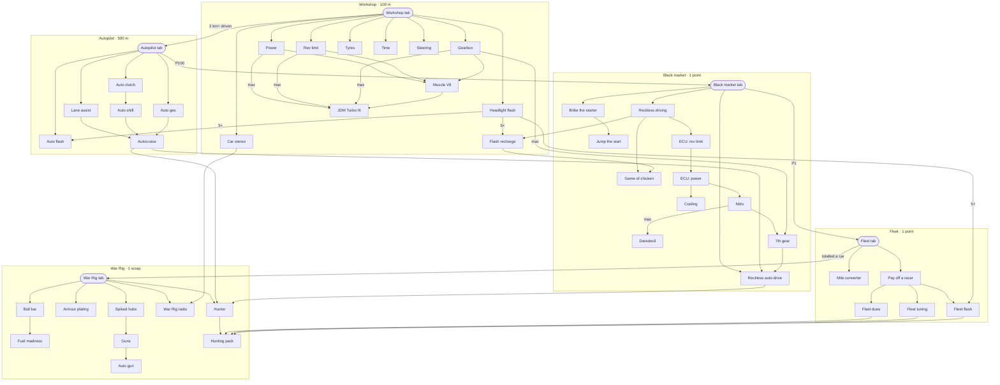

# The upgrade graph

The owner's design (drawn 23 Oct, settled in this file): every tab is bought now, at a suggested price, so every
upgrade has a parent, and what shows follows the graph (the rules below).

How it reads: an arrow points from what an upgrade needs to the upgrade. **max** on an arrow: that parent maxed. **5+**:
five levels of it. A label on a tab's arrow is a condition besides the price.

## The tabs

| Tab | Price | Needs | And |
|---|---|---|---|
| Workshop | 100 m | nothing: the first buy | |
| Autopilot | 500 m | Workshop | 2 km+ driven |
| Black market | 1 point | Autopilot | P100 |
| Fleet | 1 point | Black market | P1 |
| War Rig | 1 scrap | Fleet | totalled a car |

## The graph

## The rules

1. **Bought is unlocked.** A tab or a card stays out of sight until one of its parents is bought. An arrow with a
   count (**max**, **5+**) counts once the count is met: 7th gear shows once its tab is bought and the Gearbox maxed.
2. **To buy it, all its parents**, counts and conditions included.
3. **Story conditions hide**: a tab waiting on one (P100, P1, a car totalled) stays out of sight until it is met and
   its parent bought. Any other condition (2 km driven) is part of its rule, in sight.
4. **In sight and locked**, a card shows its name and its whole rule, what is done ticked. A parent still out of sight
   shows as ???.
5. **A tab is bought by tapping it** in the tab row, where it shows with its price once in sight.
6. **Free cards** (the Mile converter) follow the same rules, with no price.
7. **Saves**: a tab counts as bought once any upgrade on it is owned, so players keep their pages.
8. **Scrap** is the War Rig's money (it was parts), in the save too.

## The chain

Each upgrade and what it needs, one line each: the list to edit.

### Workshop (100 m; needs nothing)

- Power ← Workshop
- Rev limit ← Workshop
- Gearbox ← Workshop
- Tyres ← Workshop
- Time ← Workshop
- Steering ← Workshop
- Car stereo ← Workshop
- Headlight flash ← Workshop
- Muscle V8 ← Power, Rev limit, Gearbox
- JDM Turbo I6 ← Muscle V8, Power max, Rev limit max, Gearbox max
- Flash recharge ← Headlight flash 5+, Reckless driving

### Autopilot (500 m; needs the Workshop, and 2 km+ driven)

- Auto clutch ← Autopilot
- Auto gas ← Autopilot
- Lane assist ← Autopilot
- Auto flash ← Autopilot, Headlight flash 5+
- Auto shift ← Auto clutch
- Autocruise ← Lane assist, Auto shift, Auto gas

### Black market (1 point; needs the Autopilot)

- Bribe the starter ← Black market
- Jump the start ← Bribe the starter
- Reckless driving ← Black market
- Game of chicken ← Reckless driving, Flash recharge
- ECU: rev limit ← Reckless driving
- ECU: power ← ECU: rev limit
- Cooling ← ECU: power
- Nitro ← ECU: power
- Daredevil ← Nitro max
- 7th gear ← Nitro, Gearbox max
- Reckless auto-drive ← Black market, Autocruise, 7th gear

### Fleet (1 point; needs the Black market, and P1)

- Mile converter ← Fleet (free)
- Pay off a racer ← Fleet
- Fleet dues ← Pay off a racer
- Fleet tuning ← Pay off a racer
- Fleet flash ← Pay off a racer, Headlight flash 5+

### War Rig (1 scrap; needs the Fleet, and a car totalled)

- Bull bar ← War Rig
- Fuel madness ← Bull bar
- Armour plating ← War Rig
- Spiked hubs ← War Rig
- Guns ← Spiked hubs
- Auto gun ← Guns
- War Rig radio ← War Rig, Car stereo
- Hunter ← War Rig, Autocruise, Reckless auto-drive
- Hunting pack ← Hunter, Fleet dues, Fleet tuning, Fleet flash

## What changes against today's game

- **The tabs are bought**: today the Workshop and the Autopilot are open from the start, the Black market opens with
  the reveal, the Fleet at P1, the War Rig with the first car totalled.
- **Muscle V8** needs Power, Rev limit and Gearbox bought; today it is 4,000 m with nothing before it.
- **JDM Turbo I6** needs the V8, and Power, Rev limit and Gearbox maxed; today 10,000 m after the V8.
- **Flash recharge** needs 5 flashes and Reckless driving; today 10, and on sale only after the reveal.
- **Game of chicken** needs Flash recharge; today Headlight flash.
- **The ECU** is a chain: ECU: rev limit, then ECU: power, then Cooling and Nitro; today all three of the first need
  only Reckless driving.
- **Jump the start** needs Bribe the starter; today it is on sale with the Black market.
- **Reckless auto-drive** needs the Black market, Autocruise and 7th gear; today Autocruise, Reckless driving, and 7th
  gear bought.
- **Daredevil** needs Nitro maxed; today everything else maxed.
- **The Fleet** needs the Black market, and the **War Rig** the Fleet.
- **Mile converter**: today's Exchange card (metres for miles), free, under the Fleet tab.
- **Fuel madness** needs Bull bar; today nothing.
- **Hunter** needs the War Rig, Autocruise and Reckless auto-drive; today Autocruise.
- **Hunting pack** needs Hunter, Fleet dues, Fleet tuning and Fleet flash; today nothing.
- **Scrap** replaces parts, the War Rig's money.

## Open

- **Flash recharge in act I.** Its first parent, Headlight flash 5+, comes long before the reveal, so by rule 1 its
  card shows in act I with ??? for Reckless driving: a hint that more is coming. Show it like that, or keep a card
  out of sight while a parent waits on a story condition?
- **A player without the Autopilot tab at the reveal** has race points and no Black market to spend them in (its parent
  is the Autopilot). The act II card could say so: "Buy the Autopilot tab: the Black market is behind it."
