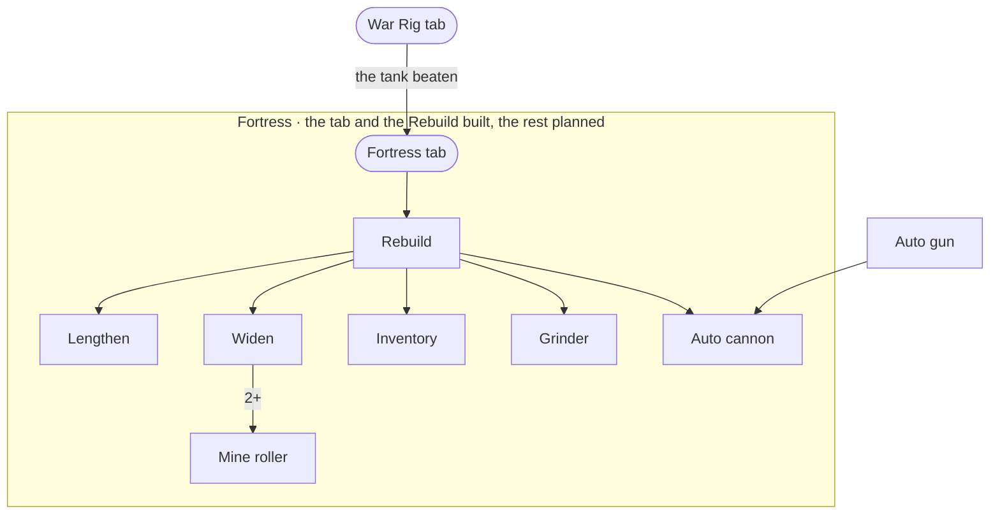

# The upgrade graph

The owner's design (drawn 23 Oct, settled in this file): every tab is bought now, at a suggested price, so every
upgrade has a parent, and what shows follows the graph (the rules below).

How it reads: an arrow points from what an upgrade needs to the upgrade. **max** on an arrow: that parent maxed. **5+**:
five levels of it. A label on a tab's arrow is a condition besides the price.

## The tabs

| Tab | Price | Needs | And |
|---|---|---|---|
| Workshop | 100 m | nothing: the first buy | |
| Autopilot | 500 m | Workshop | 2 km+ driven |
| Black market | 1 point | Workshop | P100 |
| Crew (the Fleet until 26 Oct) | 1 point | Black market | P1 |
| War Rig | 1 scrap | Crew | totaled a car |
| Fortress (act 5, being built) | 1 scrap | War Rig | the tank beaten |

## The graph

```mermaid
flowchart TD
  subgraph W["Workshop · 100 m"]
    workshop(["Workshop tab"])
    power["Power"]
    rev["Rev limit"]
    gears["Transmission"]
    tires["Tires"]
    time["Time"]
    steering["Steering"]
    stereo["Car stereo"]
    flash["Headlight flash"]
    v8["Muscle V8"]
    i6["JDM Turbo I6"]
    recharge["Flash recharge"]
  end
  subgraph A["Autopilot · 500 m"]
    autopilot(["Autopilot tab"])
    clutch["Auto clutch"]
    gas["Auto gas"]
    steer["Lane assist"]
    autoflash["Auto flash"]
    shift["Auto shift"]
    cruise["Autocruise"]
  end
  subgraph B["Black market · 1 point"]
    black(["Black market tab"])
    grid["Bribe the starter"]
    rolling["Jump the start"]
    reckless["Reckless driving"]
    chicken["Game of chicken"]
    ecuRev["ECU: rev limit"]
    ecuPower["ECU: power"]
    cooling["Cooling"]
    nitro["Nitro"]
    daredevil["Daredevil"]
    gear7["7th gear"]
    rcruise["Reckless auto-drive"]
  end
  subgraph F["Crew · 1 point"]
    fleetTab(["Crew tab"])
    converter["Fuel converter"]
    payoff["Pay off a racer"]
    pace["Crew tuning"]
    dues["Racing"]
    harvesting["Harvesting"]
    brewing["Brewing"]
    crude["Crude tank"]
    sonar["Sonar range"]
    scouting["Scouting"]
    overfill["Overfill"]
    wells["Deep wells"]
    double["Double up"]
    foreman["Foreman"]
  end
  subgraph R["War Rig · 1 scrap"]
    warrig(["War Rig tab"])
    bullbar["Bull bar"]
    madness["Fuel madness"]
    armor["Armor plating"]
    spikes["Spiked hubs"]
    guns["Guns"]
    autogun["Auto gun"]
    radio["War Rig radio"]
    hunter["Hunter"]
    pack["Raiders"]
  end

  workshop --> power & rev & gears & tires & time & steering & stereo & flash
  power --> v8
  rev --> v8
  gears --> v8
  power -- max --> i6
  rev -- max --> i6
  gears -- max --> i6
  v8 --> i6
  flash -- "5+" --> recharge
  reckless --> recharge

  workshop -- "2 km+ driven" --> autopilot
  autopilot --> clutch & gas & steer & autoflash
  flash -- "5+" --> autoflash
  clutch --> shift
  steer & shift & gas --> cruise

  workshop -- "P100" --> black
  black --> grid & reckless & rcruise
  grid --> rolling
  reckless --> chicken & ecuRev
  recharge --> chicken
  ecuRev --> ecuPower
  ecuPower --> cooling & nitro
  nitro -- max --> daredevil
  nitro --> gear7
  gears -- max --> gear7
  cruise --> rcruise
  gear7 --> rcruise

  black -- P1 --> fleetTab
  fleetTab --> converter & payoff
  payoff --> pace
  fleetTab -- "the first crude" --> dues & harvesting
  fleetTab -- "the first fuel" --> brewing
  harvesting --> crude & sonar & wells
  sonar --> scouting
  harvesting & brewing --> overfill
  overfill --> double
  double --> foreman

  fleetTab -- "totaled a car" --> warrig
  warrig --> bullbar & armor & spikes & radio & hunter
  bullbar --> madness
  spikes --> guns
  guns --> autogun
  stereo --> radio
  cruise --> hunter
  rcruise --> hunter
  hunter --> pack
  dues & pace --> pack
```

## The rules

1. **Bought is unlocked.** A tab or a card stays out of sight until one of its parents is bought. An arrow with a count
   (**max**, **5+**) counts once the count is met: 7th gear shows once its tab is bought and the Transmission maxed.
2. **To buy it, all its parents**, counts and conditions included.
3. **Story conditions hide**: a tab waiting on one (P100, P1, a car totaled) stays out of sight until it is met and
   its parent bought. Any other condition (2 km driven) is part of its rule, in sight.
4. **In sight and locked**, a card shows its name and its whole rule, what is done checked. A parent still out of sight
   shows as ???: Flash recharge's in act I (Reckless driving) is a teaser, the owner's call.
5. **A tab is bought by tapping it** in the tab row, where it shows with its price once in sight.
6. **Free cards** (the Fuel converter) follow the same rules, with no price.
7. **Saves**: a tab counts as bought once any upgrade on it is owned, so players keep their pages.
8. **Scrap** is the War Rig's money (it was parts), in the save too.

## The chain

Each upgrade and what it needs, one line each: the list to edit.

### Workshop (100 m; needs nothing)

- Power ← Workshop
- Rev limit ← Workshop
- Transmission ← Workshop
- Tires ← Workshop
- Time ← Workshop
- Steering ← Workshop
- Car stereo ← Workshop
- Headlight flash ← Workshop
- Muscle V8 ← Power, Rev limit, Transmission
- JDM Turbo I6 ← Muscle V8, Power max, Rev limit max, Transmission max
- Flash recharge ← Headlight flash 5+, Reckless driving

### Autopilot (500 m; needs the Workshop, and 2 km+ driven)

- Auto clutch ← Autopilot
- Auto gas ← Autopilot
- Lane assist ← Autopilot
- Auto flash ← Autopilot, Headlight flash 5+
- Auto shift ← Auto clutch
- Autocruise ← Lane assist, Auto shift, Auto gas

### Black market (1 point; needs the Workshop, and reaching P100)

- Bribe the starter ← Black market
- Jump the start ← Bribe the starter
- Reckless driving ← Black market
- Game of chicken ← Reckless driving, Flash recharge
- ECU: rev limit ← Reckless driving
- ECU: power ← ECU: rev limit
- Cooling ← ECU: power
- Nitro ← ECU: power
- Daredevil ← Nitro max
- 7th gear ← Nitro, Transmission max
- Reckless auto-drive ← Black market, Autocruise, 7th gear

### Crew (1 point; needs the Black Market, and reaching P1; the Fleet until 26 Oct)

- Fuel converter ← Crew (free; the Mile converter until 26 Oct)
- Pay off a racer ← Crew
- Crew tuning ← Pay off a racer (Fleet tuning)
- Racing ← Crew, the first crude (Fleet dues)
- Harvesting ← Crew, the first crude
- Brewing ← Crew, the first fuel
- Crude tank ← Harvesting
- Sonar range ← Harvesting
- Scouting ← Sonar range
- Deep wells ← Harvesting
- Overfill ← Harvesting, Brewing
- Double up ← Overfill
- Foreman ← Double up (Scouting max and Sonar range max too until 27 Oct)

### War Rig (1 scrap; needs the Crew, and a car totaled)

- Bull bar ← War Rig
- Fuel madness ← Bull bar
- Armor plating ← War Rig
- Spiked hubs ← War Rig
- Guns ← Spiked hubs
- Auto gun ← Guns
- War Rig radio ← War Rig, Car stereo
- Hunter ← War Rig, Autocruise, Reckless auto-drive
- Raiders ← Hunter, Racing, Crew tuning (the Hunting pack until 27 Oct: a role of the crew's now)

### Fortress (1 scrap; needs the War Rig, and the tank beaten; act 5, built from 30 Oct)

- Rebuild ← Fortress (1,500 points: the car rebuilt as a war rig, no shifter or pedals, the aids it drives with
  bolted on; the tank's cannon in the hold, the 1×1 board, the firing pedal)
- Its page keeps a work sign, under construction, while the rest is built. The other cards are planned (below).

## The Crew page (26 Oct)

Act 3 rebuilt as the crew (design notes: Act 3 redesign). The Fleet became the Crew on 26 Oct: the tab, the page and
the cards renamed (Fleet dues is Racing, Fleet tuning Crew tuning), the ids kept for the saves. The crew's oil came
with the next layer, and the Foreman (it sends the crew for you) after it, all in the graph above.

**The first crude** and **the first fuel** come in the scripted run after the 5th car (the oil puddle, then the
refinery). They are story conditions, and on a card they hide as a tab's do (rule 3): no role or role upgrade is named
before the run that brings it.

**Gone:** Fleet flash (it never fired at P1), team places' miles (they pay points), miles (fuel, one for one). **Act
4's layer** (27 Oct): the Hunting pack became Raiders, a role on the role card once bought, its card where the pack's
was.

## The Fortress page (act 5, planned 29 Oct)

Act 5 as decided (design notes: Act 5), being built: its tab and the Rebuild since 30 Oct (in the chain above); its
other cards still planned, what is settled and Claude's first guesses, in their own graph until they are built. The owner's: the page, the Rebuild first, the grid growing longer and wider (a lane a
step, four at most), the inventory (one slot to three), the Grinder, and a late upgrade against mines. Claude's,
open: the names Lengthen, Widen, Inventory and Mine roller, what needs what beyond the Rebuild, the automation, and
every price. The page's cards are paid in different currencies (scrap, fuel, meters, points), each card's its own, as
the tabs already are.

- Fortress tab ← War Rig tab, the tank beaten (a story condition: out of sight until then)
- Rebuild ← Fortress tab (the tank's parts: the car rebuilt into a war rig, the cockpit with it, the 1×1 grid and the
  tank's cannon to place)
- Lengthen ← Rebuild (a row a level)
- Widen ← Rebuild (a lane a level, to four)
- Inventory ← Rebuild (one slot to three)
- Grinder ← Rebuild (eats what it reaches; at four lanes, the oncoming traffic too)
- Mine roller ← Widen 2+ (mines do no damage; by three lanes there is little room left to steer round one)
- Auto cannon ← Rebuild, Auto gun (fires the cannon for you, as Auto gun does the guns)

The loot isn't on the page: the notable enemies drop it on the road. The automation of the loot (picking it up;
placing it) is open.

## What changed (23 Oct), against the game before

- **The tabs are bought**: the Workshop and the Autopilot were open from the start, the Black market opened with the
  reveal, the Fleet at P1, the War Rig with the first car totaled.
- **Muscle V8** needs Power, Rev limit and Transmission bought; it was 4,000 m with nothing before it.
- **JDM Turbo I6** needs the V8, and Power, Rev limit and Transmission maxed; it was 10,000 m after the V8.
- **Flash recharge** needs 5 flashes and Reckless driving; it needed 10, and was on sale only after the reveal.
- **Game of chicken** needs Flash recharge; it needed Headlight flash.
- **The ECU** is a chain: ECU: rev limit, then ECU: power, then Cooling and Nitro; the first three needed only Reckless
  driving.
- **Jump the start** needs Bribe the starter; it was on sale with the Black market.
- **Reckless auto-drive** needs the Black market, Autocruise and 7th gear; it needed Autocruise, Reckless driving, and
  7th gear bought.
- **Daredevil** needs Nitro maxed; it needed everything else maxed.
- **The Fleet** needs the Black market, and the **War Rig** the Fleet.
- **Mile converter**: the Exchange card (meters for miles), free, under the Fleet tab.
- **Fuel madness** needs Bull bar; it needed nothing.
- **Hunter** needs the War Rig, Autocruise and Reckless auto-drive; it needed Autocruise.
- **Hunting pack** needs Hunter, Fleet dues, Fleet tuning and Fleet flash; it needed nothing.
- **Scrap** replaces parts, the War Rig's money.
- **Team places** (the Fleet, not an upgrade): at the finish each fleet car's place pays miles, a tenth of a mile for
  each ten places from the back (the act to 51 cars in 10–12 races; it took 14–16).
